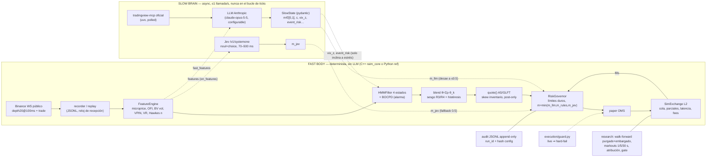

# Arquitectura de RAIM

## Invariantes
1. Las flechas punteadas solo transportan **multiplicadores o contexto**; ninguna lleva precios ni órdenes.
2. `m_aplicado = min(m_llm, m_rules, m_jev)` ∈ [0,1]; NaN ⇒ 0; halt latched.
3. Todo el tiempo del motor es **reloj de recepción**.
4. Si el slow brain o Jev caen: m_llm decae hacia ≤0.5, m_jev = 0.5; el fast body sigue.
5. No existe ejecutor live.

## Módulos
| Capa | Python | C++ |
|---|---|---|
| Features | `core/features_ref.py` | `FeatureEngine` |
| Filtro HMM | `core/hmm_ref.py` (fit: `regime/hmm_fit.py`) | `HMMFilter` |
| Quoter | `core/quoter_ref.py` | `quote` |
| Riesgo | `core/governor_ref.py` | `RiskGovernor` |
| Simulador | `core/simexchange_ref.py` (+ `sim/engine.py`) | `SimExchange` |
| Slow brain | `slowbrain/*`, `runtime.py` | — |
| Jev | `jev/adapter.py` | — |
| Investigación | `research/*` | — |
